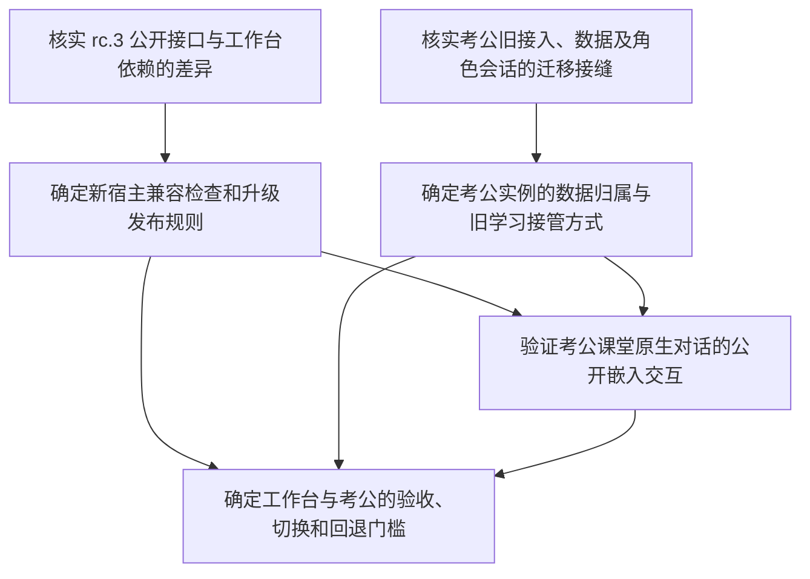

# 工作台与考公升级：决策操作入口

唯一地图：[工作台与考公面向新 Harness 的兼容及迁移路线](map.md)。这是规划跟踪，不是实施完成清单。范围已获用户确认：当前 rc.3 为首个目标，未来版本逐版验证，旧 alpha.2 仅保留冻结回退包。

## 查询与认领

在本目录运行 `./frontier.ps1` 查询可领取工单；`./frontier.ps1 -All` 显示全部子工单及实际阻塞状态。查询从工单 frontmatter 读取，不从本页静态列表推断状态。领取时先设置工单 assignee；解决后在工单追加 Resolution，关闭 status，再在地图增加一行标题链接与摘要。

## 决策依赖

研究可并行；用户决策逐个处理。研究报告留在各自 research 分支，工单 Resolution 链接精确提交中的报告；主地图不合并研究分支。规划结果确认后再交给 to-spec / to-tickets，不直接生成伪完成的实施工单。

## 环境资料

- [工作台接入步骤与影响](../../worktable-integration.md)
- [原生 rc.3 构建与启动记录](../../harness-rc3-readiness.md)：本任务实例后来已应用户要求停止，运行记录不代表当前进程状态。
- [清理与原数据保护](../../harness-working-tree-inventory.md)
- [完整框架规格](../worktable-platform/framework-spec.md)：旧要求继续保留。
