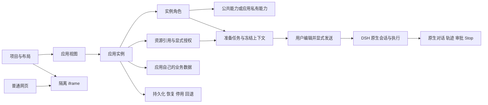

# 工作台实现技术路线与后续待办 · 2026-10-20

2026-10-22当前前沿：12、13、14、16、18已按各票实际范围关闭；15原生AI生成追改、17受控网页桥接待启动，19等待最终闭环和两轴审查。独立3091已官方安装Worktable0.8.4（SHA256 41993c880f28db940a2a7b8e418cdb8e4cb93af6b9211a5b862a30dacb54fbbf），公开peer检查0；[14真实安装证据](implementation/evidence/14-installed.json)与[18真实升级证据](implementation/evidence/18-installed.json)分别限定验收范围。3080仍保持原部署，完整spec仍open；历史映射与较早日期记录不变，本轮增量尚未推送。

## 路线已转实施 · 2026-10-21

[12—19任务图](implementation/README.md)已依据[后续范围](continuation-spec.md)发布，首次前沿12/13/16已合入源码并进入独立3091安装验收。14依赖12+13，15依赖14，17依赖14+16，18依赖12+16，19负责全部最终实页验收与固定基线两轴审查。各票的真实状态与证据优先于本页旧建议；本轮未完成点不可由首阶段关闭代替。当前版本、归档及部署状态见[STATUS](../../STATUS.md)。

定位：基于 Worktable 的通用 **AI 工作台平台插件**。项目组织应用，应用拥有实例，视图展示实例；应用可以直接开发接入，完整可视化搭建器后续补齐。考公是未来消费者之一，不进入平台通用合同。当前源代码检查点 `b99cdcd`，分支 `codex/worktable-framework`；先看[接续交接](handoff.md)。

## 已实现的结构

同实例的完整页/摘要共享状态，不同实例默认隔离；项目关联保留实例与会话身份。模块可以只展示数据，不要求每个模块创建对话。跨实例访问显式授权，公共 Agent/Skill 的复用不共享原生会话。

| 层次 | 实际代码接缝 | 已落实的责任与边界 |
|---|---|---|
| 布局与模块 UI | `plugins/worktable/01_content/src/client/`；`split.tsx`、`applicationEntry.tsx`、`applicationViews.tsx` | 延续 Worktable 项目/布局/窗格；应用入口与多视图；原生 composer 保持唯一 |
| SDK 与应用注册 | `src/sdk.mjs`、`src/sdk.d.ts`；`src/framework/applications.mjs`、`host.mjs` | `dsh-worktable/sdk` 协议 v1、能力探测、贡献撤销；应用不导入平台私有源码 |
| 数据与授权 | `src/framework/resources.mjs`、`resource-host.mjs`、`admission.mjs` | 视图推导 consumer、owner 验证 schema/revision、读写分别授权、撤销阻断后续访问 |
| 角色与能力 | `roles.mjs`、`role-host.mjs`、`role-native.mjs`、`capabilities.mjs`、`capability-native.mjs` | 实例角色绑定原生 Session；应用私有能力保留归属，公共目录只采用管理入口记录 |
| 任务与原生执行 | `tasks.mjs`、`task-host.mjs`；客户端 `taskPanel.tsx`、`taskHandoff.tsx`、`sessionCompat.ts` | prepare/edit/cancel/submit 分开；提交前复验上下文；固定会话一次准入，结果未知不自动重放 |
| 存储与生命周期 | `persistence.mjs`、`state-schema.mjs`、`applications.mjs`；[生命周期协议](09-lifecycle-protocol.md) | 并发冲突、冷恢复、停用与兼容回退；停用不删业务记录，平台回退不恢复整份用户 profile |
| 独立消费者 | [Project Notes](../../../plugins/project-notes/src/)、[Reading](../../../plugins/reading-statistics/src/) | 自有数据、业务规则、视图和能力；通过 SDK 接入，不在平台增加应用特判 |

表中简写文件路径以 `plugins/worktable/01_content/` 为根，角色/任务等服务文件位于 `src/framework/`。源码核对以 [SDK v1 合同](implementation/10-sdk-contract.md)和对应文件为准。

协议 v1 冻结的七项能力为 application-registration、instance-view、resource-reference、instance-role、application-private-capability、prepared-task、application-lifecycle（公开 feature 名均带 `-v1`）。包版本、协议版本、应用 settingsVersion、业务 schema 与平台私有存储 schema 分开演进。新增可选能力走 feature 探测；破坏必需字段或语义时须明确新协议/迁移，不靠放宽版本绕过失败。

普通网页保留隔离 iframe 与 no-referrer，不获得原生或数据能力。深度应用的资源引用不等于任意业务自动转换，插件机制也不是针对恶意可信插件代码的安全沙箱。

## 实施路径与实际结果

| 阶段 | 工单 | 实际交付 |
|---|---|---|
| 基线与关键交互 | 01–02 | 保护用户改动与上游脏工作树来源；原型方向经用户实际确认 |
| 接入与隔离 | 03–04 | 网页、未归属实例、项目关联、深度应用、多视图、实际拖动与身份保持 |
| 数据与原生 AI | 05–07 | 显式授权/撤销、角色隔离、公私能力、任务上下文、真实原生 Skill/问题/审批/Stop |
| 恢复与扩展合同 | 08–10 | 持久化与冷启、冲突拒绝、停用/兼容回退、第二应用独立接入、SDK v1 冻结 |
| 阶段验收 | 11 | 原生导航修复、最终包 UI、窄屏/主题/焦点/滚动/冷恢复、固定基线两轴审查与172项映射 |

各阶段只认其实际安装版本与用户流程，不能把旧版本模型调用说成最终小版本又重跑过模型。最终包为 Worktable 0.7.2（精确9文件）+ Notes 0.1.2（精确5文件）+ E11 固定 Reading 组合；最初7文件白名单已由10的公开SDK合同明确扩展。

证据入口：[11 验收](implementation/11-acceptance.md)、[E11](implementation/evidence/11-installed.json)、[授权共享补验 E11S](implementation/evidence/11-authorized-notes-sharing.json)、[Standards/Spec 两轴审查](implementation/11-review.md)。源码回归和精确包安装是辅助证据，不能替代实际使用。两轴审查基线为 `485b38cfd9a5d10de5a668ea4864246d4b1ebea7`；审查修复后无待处理 actionable finding，保留 P3 重复路由边界建议及接受理由。

## 完整规格仍未完成的框架要求

以下编号对应 [framework-spec 用户故事](framework-spec.md)，状态来自 [172 条映射](implementation/11-acceptance-mapping.json)。不更改原 spec，也不把部分通过写成整条完成。

| 故事 | 当前缺口 | 补齐时需要的实际证据 |
|---|---|---|
| 19 | running/waiting/failed/cancelled/unread 全矩阵未齐 | 在真实原生任务中补 failed/unread 等状态及打开/切换后的正确显示 |
| 23（后续保留） | 生成结果挂载、追改及迟到结果归属未形成完整链 | 实际生成、追改、Stop、替换模块后旧结果不覆盖新目标；保留原生轨迹 |
| 27 | 已有并发冲突，但真实磁盘/ACL 写失败恢复未验 | 可控故障下真实保存失败提示、旧数据保全、恢复后重试且不假报成功 |
| 32（后续保留） | 完整组合/搭建应用运行链未交付 | 搭建器生成的应用复用同一运行合同，而非另一套实例与执行系统 |
| 37 | 通用 Stats/List/Detail/筛选组件库及生成主题未完整发布 | 两个独立应用通过公共组件组合，字段映射/空态/错误/主题/窄屏可用 |
| 44 | 旧资料、成绩、凭据、历史的完整迁移未验 | 基于实际旧数据清单比对；考公专项恢复后单独验收，不能由 Notes/Reading 推定 |
| 48 | 未执行真实不可逆业务迁移及影响确认 | 具体应用迁移前解释影响并明确确认，失败保护及恢复边界实际验证 |
| 49 | 不兼容回退已拒绝保字节，未知不兼容升级全路径未验 | 真实不兼容升级被阻止、记录不清空、明确提示与可行恢复路径 |

框架49项合计41已验/6未验/2后续；叠加旧123项后共66已验/94未验/12后续。旧要求还保留：完整搭建和生成、目录管理组合能力、旧浮窗行为迁移、Better Sidebar 组合兼容、旧原生恢复、考公老师/题目/资料/成绩完整闭环。新阶段同类局部证据不能直接关掉旧阶段更大范围的要求。

## 后续建议路线

以下是交接时的**建议优先级**，尚未作为新工单发布，不承诺完成日期。继续实施前按用户选定范围形成增量 spec/工单，保留上述原始要求及证据归属。

| 顺序 | 方向 | 具体调整 | 完成判据 |
|---|---|---|---|
| P1 | 先改善日常操作 | 保持“项目选布局 → 模块内配置 → 旁边原生对话”；收起协议/授权细节；区分完整页/摘要标签；原始ID与错误换成可定位的友好文案 | 用户从空项目开始，直接在模块选择网页/应用视图/自定义等内容；继续、新建、关联项目操作清楚，原生菜单不变 |
| P2 | 完整搭建器与展示组件 | 复用已冻结实例/视图合同；模块内配置页面、数据、角色；草稿→预览→显式启用；补卡片、统计、列表、详情、筛选的共用组件 | 两个不同应用无需修改平台源码即可搭建运行；展示模块不强迫绑定对话；地图数据由应用提供 |
| P3 | AI 生成与追改 | 复用原生会话与任务准入；把标注、生成产物和目标模块稳定关联，处理替换、迟到、取消和失败 | 在真实模型中由描述生成模块、修改同一模块；取消或关闭不会误发，旧结果不覆盖替换后的模块 |
| P4 | 故障、兼容与迁移 | 补状态矩阵、真实存储失败、未知升级、不可逆迁移确认；按目标宿主逐版本验证 | 对应未验故事逐条获得真实用户流程证据，不能只靠夹具或构建通过 |
| P5 | 再接考公专项 | 复用平台合同；保持题目/原文/图片/答案来源和角色私有能力归属；检查旧数据 | 用户恢复专项后按原资料和教学闭环工单验收，不先清理旧数据或目录 |

网站高级桥接仍为后续能力，需要独立权限和宿主支持设计；基础网页接入不代表桥接已做。完整内嵌原生标题栏、未发送图片自动恢复仍缺公共接口，当前边界为同 Session 原生视图、从标注历史重新附加图片；原要求保留待上游支持，不为补齐它们修改原生仓库。

多用户、应用市场、云服务以及任意数据库/API的通用低代码平台不在当前已批准范围，不能从上述路线推定新增承诺。后续扩展优先保持公开 SDK、应用数据归属、显式授权、唯一原生输入与版本化恢复边界。
